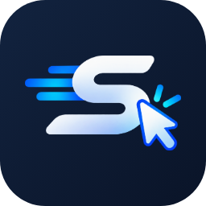

<p align="center">
  
</p>

<h1 align="center">Sima</h1>

<h3 align="center">Your AI learning assistant in Chrome</h3>

<p align="center">
  <a href="LICENSE"></a>
  
  
  
  
  
  
  
  
  
  
  
  
  
</p>

Sima is an open-source Chrome extension that helps you understand learning activities. It reads the questions on a supported page, works through them with the AI provider you choose, and explains its reasoning. If your course allows it, Sima can also enter the answers for you to check before you submit.

**Status: early development.** VHL Central now handles real activities, but it has only been tried on a few. Gradescope and WebAssign have only been tested against local mock pages. See [Known limitations](#known-limitations).

## What Sima won't do

- **It never submits work.** Saving and submitting are always yours to do.
- **It stays off on exams and quizzes.** It also stays off on proctored or timed activities, and on activities that say AI isn't allowed. There's no override.
- **It doesn't enter anything unasked.** The first time you click **Fill answers** on an activity, Sima asks you to confirm that AI help is allowed there. Your answer lasts for that whole activity.

You're responsible for following your course's academic integrity policy. If you're unsure whether AI help is allowed, ask your instructor first.

## Install

You need Chrome 127 or newer. Sima isn't on the Chrome Web Store, so you install it in Developer mode.

1. Download the latest `.zip` from the [Releases page](https://github.com/ruthwik-dhama/sima/releases/latest).
2. Unzip it, and put the folder somewhere permanent. Chrome loads Sima from this folder, so deleting or moving it removes the extension.
3. Go to `chrome://extensions` and turn on **Developer mode** at the top right.
4. Click **Load unpacked** and choose the unzipped folder.
5. Click the puzzle-piece icon in the toolbar, then pin Sima.

**Set up an AI provider:** click the Sima icon on any site. Your birth date is the first thing it asks, and setting up AI is the second. If you're 18 or older, Sima uses Google Gemini's free tier: click **Set up Gemini** and follow the short steps to copy a free key from Google and paste it in. If you're under 18, Sima uses a local model through Ollama, which keeps question text on your computer. Gemini's free tier isn't available in the EEA, Switzerland or the UK, so choose Ollama there. See the [privacy terms](docs/PRIVACY.md) and [provider guide](docs/PROVIDERS.md).

**Use it:** open an activity on a supported site, click the Sima icon, and click **Fill answers** or **Explain only**.

**Update it:** download the new `.zip`, replace the contents of the same folder, and click the reload arrow on the Sima card at `chrome://extensions`. Updates aren't automatic, so watch the repository's releases to hear about new versions.

If you see "Sima can't read this page yet", Sima doesn't understand that page's layout. You can help add support: see [Testing on real sites](docs/TESTING-LIVE-SITES.md). The downloaded version can't open the mock activities, so to try those, build from source and follow [Try it on the mock platforms](#try-it-on-the-mock-platforms).

## Build from source

You need Node.js 22 or newer and Chrome 127 or newer.

```bash
corepack enable
pnpm install
pnpm --filter @sima/extension prepare:wxt
pnpm build
```

Then load it in Chrome:

1. Go to `chrome://extensions` and turn on **Developer mode**.
2. Click **Load unpacked** and choose `apps/extension/.output/chrome-mv3`.
3. Click the Sima icon in the toolbar, enter your birth date, and set up a provider. See [docs/PROVIDERS.md](docs/PROVIDERS.md).

## Try it on the mock platforms

The production build can't access localhost pages, so use the development build:

```bash
pnpm playground
```

```bash
pnpm build:e2e
```

Load `apps/extension/.output-e2e/chrome-mv3` as above, then open http://localhost:5199.

## Development

```bash
pnpm typecheck
```

```bash
pnpm lint
```

```bash
pnpm test
```

```bash
pnpm test:e2e
```

End-to-end tests need Chromium once: `pnpm exec playwright install chromium`. They use a local fake model server, so no API key or model is needed.

## Known limitations

- **Live support is limited.** VHL Central has been tried on only a few real activities, so other layouts may not work. Gradescope and WebAssign adapters only understand the local mock pages, so their real pages show "Sima can't read this page yet". See [Testing on real sites](docs/TESTING-LIVE-SITES.md).
- **Answers can be wrong, so check them.** Accuracy depends on the model. Gemini got every question right on one real VHL activity, while a small local model (`qwen2.5:7b`) got 14 of 24 on a local test set. These are small tests, not a guarantee.
- **Gemini's free tier has limits.** Google doesn't publish fixed numbers, and Gemini can be busy at times. Sima retries when it is, but you may still have to try again later.
- **Restriction detection is a heuristic.** It reads titles and visible text, so it can miss a restriction stated elsewhere, such as in a syllabus, or block a legitimate activity. A miss doesn't change your obligation to follow course rules.
- **Images aren't sent to models.** Only their descriptions are, and confidence is capped when a description is missing.
- **Only top-level documents are read.** Questions inside iframes aren't detected, and rich-text editors built on iframes can't be filled.
- **API keys are stored unencrypted** in your Chrome profile, like most extensions' settings.
- **OpenAI and Anthropic are untested on their live APIs.** Their requests are only tested with mocked responses. Gemini has been used on real activities, and automated tests run the Ollama path against a fake local server.

## Documentation

- [Architecture](docs/ARCHITECTURE.md)
- [Privacy terms](docs/PRIVACY.md)
- [Security](docs/SECURITY.md)
- [AI providers](docs/PROVIDERS.md)
- [Testing on real sites](docs/TESTING-LIVE-SITES.md)
- [Contributing](CONTRIBUTING.md)

MIT licensed. Not affiliated with Gradescope, Vista Higher Learning, WebAssign or Cengage.
